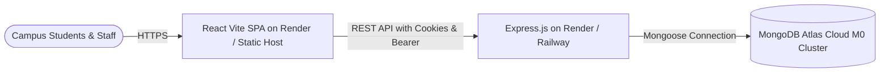

# CampusFix — Cloud Deployment Guide (Render & Railway)

This guide walks you through deploying **CampusFix** to the cloud using **Render** or **Railway** with a free **MongoDB Atlas** database cluster.

---

## Architecture in Production



---

## Step 1: Set up MongoDB Atlas (Free Cloud Database)

1. Go to [MongoDB Atlas](https://www.mongodb.com/cloud/atlas) and sign in or create a free account.
2. Click **Create** to deploy a free **M0 (Shared)** cluster:
   - Provider: AWS
   - Region: Select the region closest to you (e.g., `us-east-1` or `eu-central-1`)
   - Cluster Name: `CampusFixCluster`
3. Under **Security → Database Access**:
   - Click **Add New Database User**.
   - Authentication Method: **Password**.
   - Username: `campusfix_admin`
   - Password: Click *Autogenerate Secure Password* (save this password!).
   - Built-in Role: **Read and write to any database**.
4. Under **Security → Network Access**:
   - Click **Add IP Address**.
   - Click **Allow Access from Anywhere** (`0.0.0.0/0`) so Render/Railway servers can connect.
   - Click **Confirm**.
5. Under **Deployments → Database**:
   - Click **Connect** next to your cluster.
   - Choose **Drivers** (Node.js).
   - Copy the connection string. It will look like:
     ```text
     mongodb+srv://campusfix_admin:<password>@campusfixcluster.xxxxx.mongodb.net/campusfix?retryWrites=true&w=majority
     ```
   - Replace `<password>` with your database user password and ensure the database name `/campusfix` is present in the path.

---

## Step 2: Seed the Remote Atlas Database (Optional but Recommended)

To populate demo accounts, departments, and sample issues directly into your cloud Atlas database:

1. Open your terminal in `CampusFix/server`.
2. Run the seed script passing your Atlas `MONGO_URI`:
   ```bash
   MONGO_URI="mongodb+srv://campusfix_admin:<password>@campusfixcluster.xxxxx.mongodb.net/campusfix?retryWrites=true&w=majority" node src/seed.js
   ```
3. Once completed, your Atlas database will contain all demo users:
   - Admin: `admin@campusfix.dev` / `Admin@123`
   - Staff: `staff@campusfix.dev` / `Staff@123`
   - Student: `student@campusfix.dev` / `Student@123`

---

## Step 3: Push Code to GitHub

Ensure your project is committed and pushed to GitHub:

```bash
cd /Users/regencypatel/Documents/class/CampusFix
git init
git add .
git commit -m "feat: complete CampusFix MERN project ready for cloud deployment"
git branch -M main
git remote add origin https://github.com/<your-username>/campusfix.git
git push -u origin main
```

---

## Step 4: Deploying on Render (Recommended)

### Method A: 1-Click Blueprint (Using `render.yaml`)

CampusFix includes a pre-configured `render.yaml` file:
1. Log into [Render.com](https://render.com).
2. Go to **Blueprints** → Click **New Blueprint Instance**.
3. Select your `campusfix` GitHub repository.
4. Render will detect `render.yaml` and configure both services:
   - `campusfix-api` (Backend Express Web Service)
   - `campusfix-web` (Frontend React Static Site)
5. Under environment variables, paste your `MONGO_URI` from Step 1.
6. Click **Apply**. Both services will build and deploy automatically!

---

### Method B: Manual Render Deployment

If you prefer setting up the services manually on Render:

#### 1. Deploy Backend API (`campusfix-api`):
1. On Render, click **New +** → **Web Service**.
2. Connect your repository.
3. Configure settings:
   - **Name**: `campusfix-api`
   - **Root Directory**: `server`
   - **Environment**: `Node`
   - **Build Command**: `npm install`
   - **Start Command**: `npm start`
   - **Instance Type**: `Free`
4. Add **Environment Variables**:
   - `NODE_ENV`: `production`
   - `PORT`: `10000`
   - `MONGO_URI`: `<Your MongoDB Atlas connection string>`
   - `JWT_SECRET`: `<A strong random secret key>`
   - `FRONTEND_ORIGIN`: `https://campusfix-web.onrender.com` (update once frontend is created)
5. Click **Create Web Service**.
6. Copy your backend URL: `https://campusfix-api.onrender.com`.

#### 2. Deploy Frontend Client (`campusfix-web`):
1. On Render, click **New +** → **Static Site**.
2. Connect your repository.
3. Configure settings:
   - **Name**: `campusfix-web`
   - **Root Directory**: `client`
   - **Build Command**: `npm install && npm run build`
   - **Publish Directory**: `dist`
4. Add **Environment Variables**:
   - `VITE_API_URL`: `https://campusfix-api.onrender.com/api`
5. Under **Redirects/Rewrites**:
   - **Source**: `/*`
   - **Destination**: `/index.html`
   - **Action**: `Rewrite` (ensures React Router SPA navigation works on refresh).
6. Click **Create Static Site**.
7. Once deployed, update `FRONTEND_ORIGIN` in your backend service with the frontend URL.

---

## Step 5: Deploying on Railway (Alternative)

1. Go to [Railway.app](https://railway.app) and click **New Project** → **Deploy from GitHub repo**.
2. Select the repository.
3. Add a Service for the Backend:
   - Settings → Root Directory: `server`
   - Build Command: `npm install`
   - Start Command: `npm start`
   - Variables:
     - `PORT`: `5001`
     - `MONGO_URI`: `<Your MongoDB Atlas connection string>`
     - `JWT_SECRET`: `<A strong random secret key>`
     - `FRONTEND_ORIGIN`: `https://<your-frontend-domain>.up.railway.app`
4. Add a Service for the Frontend:
   - Settings → Root Directory: `client`
   - Build Command: `npm run build`
   - Start Command: `npx serve -s dist -l $PORT`
   - Variables:
     - `VITE_API_URL`: `https://<your-backend-domain>.up.railway.app/api`
5. Generate domains under **Settings → Networking** for both services.

---

## Verification Checklist After Deployment

- [ ] Open frontend URL in browser and verify the login screen loads.
- [ ] Sign in using 1-Click demo accounts (`Student`, `Staff`, or `Admin`).
- [ ] Submit a new issue ticket with image attachment.
- [ ] Test the live duplicate issue detector by typing a similar title.
- [ ] Verify that the Admin Operations Analytics dashboard displays MongoDB aggregation metrics and Recharts visualizations.
- [ ] Test refreshing any page (`/issues`, `/dashboard`, `/admin`) to verify client-side SPA routing works properly.
