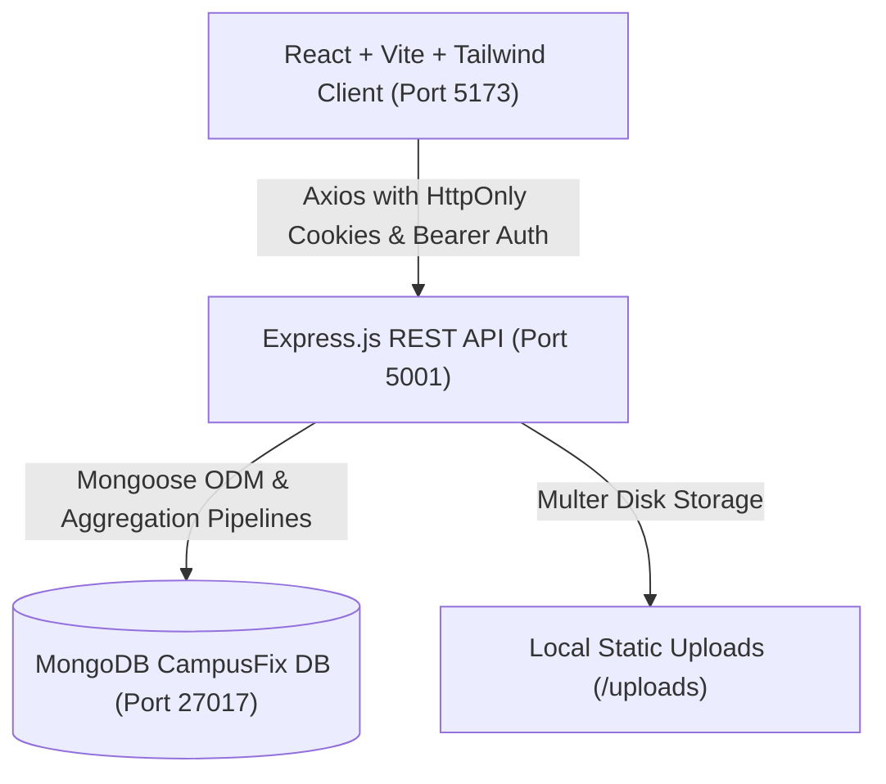

# CampusFix — Implementation Plan & Architecture Specification

## 1. Executive Summary & Architecture Overview

CampusFix is a production-grade campus issue reporting and resolution platform built using the MERN stack (MongoDB, Express.js, React, Node.js). It provides a unified, role-driven operations workflow for three distinct user types:
- **Students**: Report infrastructure/facility problems, detect duplicates in real-time, vote on community issues, track status history, comment, and reopen persistent issues.
- **Staff**: Manage assigned department workload, acknowledge tickets, post progress updates, and execute permitted status transitions.
- **Administrators**: Maintain campus-wide oversight, manage departments and user accounts, reassign tickets, and monitor operational efficiency through MongoDB aggregation-backed analytics.

---

## 2. Technology Stack & Key Libraries

| Tier | Technology | Purpose |
| :--- | :--- | :--- |
| **Frontend Framework** | React 19 + Vite 8 | Ultra-fast SPA development, HMR, and optimized production bundle |
| **Routing** | React Router DOM v7 | Role-based protected routes and nested dashboard layouts |
| **Styling** | Tailwind CSS v3 | Polished SaaS design system (Navy/Indigo palette, responsive layouts) |
| **Icons** | Lucide React | Modern, accessible iconography |
| **Analytics Charts** | Recharts v3 | Responsive operational charts (Bar, Area, Pie/Donut, Tooltips) |
| **HTTP Client** | Axios | Configured with credentials, interceptors, and error handling |
| **Backend Framework** | Node.js + Express.js 5 | Robust RESTful API architecture |
| **Database** | MongoDB + Mongoose 9 | Document persistence, schema validation, and indexing |
| **Authentication** | JWT + bcryptjs | HttpOnly cookie-based + header-compatible secure authentication |
| **Validation** | Zod | Strict schema validation for registration, issues, and departments |
| **File Uploads** | Multer | Multi-image attachment support with MIME and size constraints |
| **Security & Rate Limiting** | express-rate-limit, CORS | Brute-force protection and origin restriction |
| **Testing** | Jest + Supertest | Automated integration tests for all API endpoints |

---

## 3. Database Schema Design (Mongoose)

### 3.1. User Model (`User`)
- `name`: `String` (required, trimmed)
- `email`: `String` (required, unique, lowercase, trimmed, indexed)
- `passwordHash`: `String` (required, hidden in JSON responses)
- `role`: `String` (`enum: ['student', 'staff', 'admin']`, default: `'student'`)
- `department`: `ObjectId -> Department` (optional, for staff members)
- `isActive`: `Boolean` (default: `true`)
- Timestamps (`createdAt`, `updatedAt`)

### 3.2. Department Model (`Department`)
- `name`: `String` (required, unique, trimmed)
- `description`: `String` (trimmed)
- `staff`: `[ObjectId -> User]`
- Timestamps (`createdAt`, `updatedAt`)

### 3.3. Issue Model (`Issue`)
- `ticketNumber`: `String` (unique, indexed, e.g. `CF-20261027-101`)
- `title`: `String` (required, trimmed)
- `description`: `String` (required, trimmed)
- `category`: `String` (`enum: ['Wi-Fi', 'Laboratory', 'Classrooms', 'Hostels', 'Cleanliness', 'Electricity', 'Other']`)
- `building`: `String` (required, trimmed, indexed)
- `floor`: `String` (trimmed)
- `room`: `String` (trimmed)
- `priority`: `String` (`enum: ['Low', 'Medium', 'High', 'Critical']`, default: `'Medium'`)
- `status`: `String` (`enum: ['Reported', 'Acknowledged', 'In Progress', 'Resolved', 'Closed']`, default: `'Reported'`)
- `reportedBy`: `ObjectId -> User` (required, indexed)
- `assignedTo`: `ObjectId -> User` (optional, indexed)
- `department`: `ObjectId -> Department` (optional, indexed)
- `attachments`: `[String]` (URLs to uploaded images)
- `votes`: `[ObjectId -> User]` (set of unique users who upvoted)
- `statusHistory`: Array of objects:
  - `status`: `String` (required)
  - `changedBy`: `ObjectId -> User` (required)
  - `changedAt`: `Date` (default: `Date.now`)
  - `note`: `String`
- `resolvedAt`: `Date` (set when status transitions to `Resolved`)
- `closedAt`: `Date` (set when status transitions to `Closed`)
- Timestamps (`createdAt`, `updatedAt`)
- Compound and text indexes for fast search and duplicate detection.

### 3.4. Comment Model (`Comment`)
- `issue`: `ObjectId -> Issue` (required, indexed)
- `author`: `ObjectId -> User` (required, indexed)
- `message`: `String` (required, trimmed)
- Timestamps (`createdAt`, `updatedAt`)

### 3.5. Notification Model (`Notification`)
- `recipient`: `ObjectId -> User` (required, indexed)
- `issue`: `ObjectId -> Issue` (optional)
- `type`: `String` (`enum: ['assignment', 'status', 'comment', 'resolved', 'reopened', 'system']`)
- `message`: `String` (required)
- `isRead`: `Boolean` (default: `false`, indexed)
- Timestamps (`createdAt`, `updatedAt`)

---

## 4. REST API Specification

### Authentication (`/api/auth`)
- `POST /register`: Register user (defaults to student; admin role escalation prevented).
- `POST /login`: Authenticate email/password; rate-limited; returns JWT and sets HttpOnly cookie.
- `POST /logout`: Clears authentication cookie.
- `GET /me`: Returns profile of authenticated user.

### Issue Lifecycle (`/api/issues`)
- `GET /`: List issues with pagination (`page`, `limit`), sorting (`createdAt`, `votes`, `priority`), search (`title`, `description`, `building`), and filters (`status`, `category`, `priority`, `mine`, `department`).
- `GET /check-duplicates`: Real-time duplicate query by `category`, `building`, and search tokens.
- `POST /`: Create new issue with optional multipart image upload.
- `GET /:id`: Retrieve issue details, populated relations, status history, and comments.
- `PATCH /:id`: Update issue details (authorized users).
- `DELETE /:id`: Delete issue (admin or original reporter if still Reported).
- `POST /:id/vote`: Toggle / record user vote (prevents duplicate votes).
- `POST /:id/comments`: Add progress update or discussion comment.
- `PATCH /:id/status`: Transition status according to permitted state machine:
  - `Reported` -> `Acknowledged`
  - `Acknowledged` -> `In Progress`
  - `In Progress` -> `Resolved`
  - `Resolved` -> `Closed` OR `Reported` (reopen by student)
  - `Closed` -> `Resolved`
- `POST /:id/assign`: Assign issue to staff member or department (admin/staff only).

### Notifications (`/api/notifications`)
- `GET /`: Retrieve current user's recent notifications with unread count.
- `PATCH /:id/read`: Mark single notification as read.
- `PATCH /read-all`: Mark all notifications as read.

### Administration & Analytics (`/api/admin`)
- `GET /analytics`: MongoDB aggregation metrics:
  - Total, open, resolved, closed, and overdue issues.
  - Resolution rate (%) and average resolution time (hours).
  - Category breakdown and status breakdown.
  - Monthly issue trends and top complaint campus locations.
  - Staff workload distribution.
- `GET /users`: List all registered users with role and status.
- `PATCH /users/:id/role`: Change user role (`student`, `staff`, `admin`).
- `PATCH /users/:id/status`: Toggle user active status (`isActive`).
- `GET /departments`: List departments with assigned staff.
- `POST /departments`: Create a new department.

---

## 5. UI/UX Design System & Layout Architecture

- **Visual Theme**: Professional SaaS aesthetic. Light slate background (`#f8fafc`), deep navy text (`#0f172a`), indigo accent (`#4f46e5` / `#6366f1`), crisp slate borders (`#e2e8f0`), soft elevated shadows (`shadow-sm`, `shadow-md`).
- **Typography**: Inter / System UI font hierarchy with high readability and accessible contrast.
- **Components**:
  - `Navbar`: Brand badge, search trigger, unread notification counter & dropdown, user profile pill, logout.
  - `Sidebar`: Role-contextual links (Student: Dashboard, Report Issue, My Issues, Browse Issues; Staff: Staff Dashboard, Assigned Workload, Campus Feed; Admin: Analytics, All Issues, User Management, Departments).
  - `StatCard`: Visual metric cards with trend indicators and Lucide icons.
  - `StatusBadge` & `PriorityBadge`: Color-coded semantic tags (e.g., Critical = Red, In Progress = Amber, Resolved = Emerald).
  - `DuplicateIssueAlert`: Real-time interactive warning on report page showing matching open issues with instant vote actions.
  - `StatusTimeline`: Interactive visual stepped tracker of ticket progression with timestamps and staff notes.
  - `ConfirmationModal`: Modal dialog for destructive or state-changing actions.
  - `LoadingSkeleton` & `EmptyState`: Contextual zero-data and loading indicators.

---

## 6. Implementation Milestones

- [x] **Milestone 1**: Workspace Inspection & Technical Specification (`IMPLEMENTATION_PLAN.md`).
- [ ] **Milestone 2**: Backend Enhancement & Test Suite (Fix vote logic, duplicate endpoint, full Jest test suite, rich seed data).
- [ ] **Milestone 3**: Frontend Foundation (Tailwind config, custom theme tokens, Axios client, Auth & Notification contexts).
- [ ] **Milestone 4**: Core User Screens (Auth pages, Student Dashboard, Issue Creator with live duplicate detector, Issue Details with timeline & comments).
- [ ] **Milestone 5**: Staff & Admin Dashboards (Staff workload management, status transition modal, Recharts analytics, user & department management).
- [ ] **Milestone 6**: End-to-End Verification (Automated tests, browser testing, performance checks, complete documentation).
